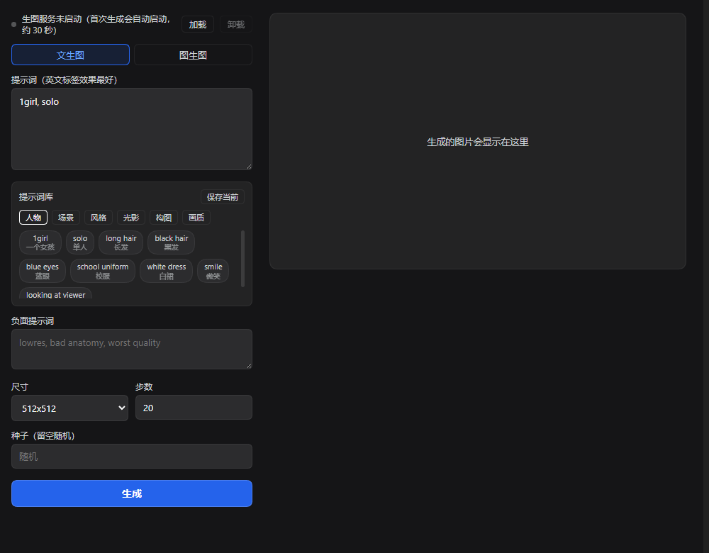
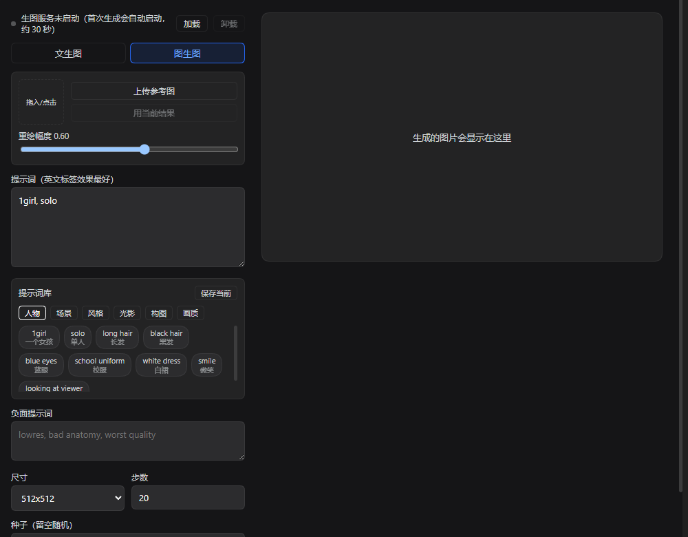

# dsh-image-studio

**在 DeepSeek Harness 里用本地 Stable Diffusion 生图**：侧边栏「生图」面板 + 模型工具 `generate_image` + `/draw` 命令 + 出图自动推到微信/QQ。

> An in-app image studio for [DeepSeek Harness](https://github.com/deepseek-ai/deepseek-harness):
> a prompt-builder panel over a local AUTOMATIC1111 Stable Diffusion WebUI, a `generate_image`
> tool the model can call, a `/draw` slash command, and one-click delivery to WeChat/QQ.

**快速安装**（桌面版）：

```bash
dsh plugin --profile desktop add git+https://github.com/RadeyesDrosophilaProMax/dsh-image-studio
```

---

## 界面

| 文生图 | 图生图 |
|---|---|
|  |  |

截图取自真实运行的面板（SD WebUI 未启动时状态显示「生图服务未启动」，首次生成会自动拉起；原生中文界面，默认深色）。

---

## 功能

- **面板生图**：中文提示词自动翻成英文 Danbooru tag；人物 / 风格 / 构图 / 光影 / 场景 一键标签；尺寸、步数、种子、负面提示词；生成历史与「打开文件夹」。
- **图生图**：拖一张参考图进面板，调重绘幅度继续改。
- **服务管理**：面板里直接启动 / 停止 AUTOMATIC1111 WebUI（固定带 `--api --nowebui --lowvram`，小显存也能跑）。
- **模型工具 `generate_image`**：模型自己决定画什么，中文 prompt 自动翻译，返回图片 URL，并自动推送到当前聊天渠道。
- **`/draw <画面描述>`**：不依赖模型工具调用的确定性命令，微信/QQ 里直接发 `"/draw 一只趴在窗台的猫"` 就出图。
- **多语言界面**：`locale/en.json`、`locale/zh.json`。

## 环境要求

| 依赖 | 说明 |
|---|---|
| Windows | 当前用 `python.exe …launch.py` 拉起 WebUI，开机自启逻辑也是 PowerShell |
| [AUTOMATIC1111 Stable Diffusion WebUI](https://github.com/AUTOMATIC1111/stable-diffusion-webui) | 已在 aki 整合包 v4.10 上测试；需要 WebUI 自带 API |
| DeepSeek Harness | 作为 Cordis bundle 插件加载（`dsh.bundle.patch`） |
| 可选：本地翻译端点 | 任意 OpenAI 兼容 `/v1/chat/completions`，例如 llama.cpp server，用于中文 → 英文 tag |
| 可选：`dsh-qqbot` / `dsh-wechat` | 出图后自动把图片发到聊天（没有就只在面板里显示） |

## 安装

### 一条命令装好（桌面版 CLI）

```bash
dsh plugin --profile desktop add git+https://github.com/RadeyesDrosophilaProMax/dsh-image-studio
```

把 `desktop` 换成你自己的 profile 名（`dsh plugin --profile <名字> list --depth 0` 可以看已装的）。
装完插件就挂上了，只剩两行要填 —— WebUI 的 Python 和安装目录：

```yaml
- insert:
    - id: sd-studio
      name: 'dsh-image-studio'
      config:
        pythonPath: D:\sd-webui-aki\python\python.exe
        installDir: D:\sd-webui-aki
```

> 没有发 npm 包，所以要用 `git+https://…` 这种地址安装；`add` 之后管理器会先 `git ls-remote` 探一次仓库连通性，再交给 pnpm。
> 卸载在 **设置 → 插件** 里移除即可（也可以用 `dsh plugin --help` 查当前版本支持的卸载子命令）。

### Web 界面安装

设置 → 插件 → 添加插件，安装源填：

```
git+https://github.com/RadeyesDrosophilaProMax/dsh-image-studio
```

装好后同样把 `pythonPath` / `installDir` 填上。

### 方式三：手动挂到 profile 的 patch

把本仓库放进 `%DSH_PROFILE_DIR%\node_modules\dsh-image-studio`（或做目录联接），再在 profile 的 `cordis.patch.yml` 追加：

```yaml
- insert:
    - id: sd-studio
      name: 'dsh-image-studio'
      config:
        pythonPath: D:\sd-webui-aki\python\python.exe
        installDir: D:\sd-webui-aki
        port: 7860
```

### 方式四：开发期用目录联接

```powershell
New-Item -ItemType Junction -Path "$env:DSH_PROFILE_DIR\node_modules\dsh-image-studio" -Target D:\path\to\dsh-image-studio
```

## 配置

| 字段 | 默认 | 作用 |
|---|---|---|
| `pythonPath` | 空 | WebUI 的 Python 解释器，整合包一般是 `<installDir>\python\python.exe` |
| `installDir` | 空 | WebUI 安装目录（含 `launch.py`）；为空时点「启动」会提示先配置 |
| `port` | `7860` | WebUI API 端口 |
| `readyTimeoutMs` | `240000` | 启动后等待就绪的上限 |
| `timeoutMs` | `180000` | 单次出图请求超时 |
| `defaultSteps` | `20` | 默认采样步数 |
| `defaultWidth` / `defaultHeight` | `512` / `512` | 默认尺寸（小显存别往上抬） |
| `wechatPush` | `true` | 出图后自动推送到聊天渠道（需 `dsh-qqbot` 或 `dsh-wechat`） |
| `translateMode` | `local` | `auto` 先云端后本地、`cloud` 只云端、`local` 只本地 |
| `translateLocalUrl` | `http://127.0.0.1:1234/v1` | 本地翻译用的 OpenAI 兼容端点 |

## 使用

1. 侧边栏点「生图」，第一次点「启动生图服务」，等状态变成已连接。
2. 写提示词（中文即可），或用标签按钮拼；点生成。
3. 在对话里直接说「画一张……」模型会调用 `generate_image`；微信/QQ 里也可以用 `/draw 画面描述`。

## HTTP 接口（面板内部用，同源）

| 方法 | 路径 | 作用 |
|---|---|---|
| GET | `/studio/api/status` | 服务是否在线、当前模型 |
| POST | `/studio/api/start` | 启动 WebUI（已在跑则直接返回） |
| POST | `/studio/api/stop` | 停止 WebUI |
| POST | `/studio/api/translate` | 中文 → 英文 tag |
| POST | `/studio/api/generate` | 文生图 |
| POST | `/studio/api/img2img` | 图生图（带参考图） |
| POST | `/studio/api/clear` | 清空历史 |
| POST | `/studio/api/reveal` | 在资源管理器里打开输出目录 |

## 目录结构

```
index.js          Host 侧：WebUI 进程管理、翻译、生图、generate_image 工具、/draw 命令、HTTP 路由
client.js         Web 侧：侧边栏「生图」面板（提示词、标签、图生图、历史）
locale/*.json     界面文案
cordis.patch.yml  bundle patch，声明插件行与默认配置
icon.svg          面板图标
docs/*.png        面板截图（文生图 / 图生图）
```

## 已知限制

- **单实例、串行**：一个 WebUI、一次生成；并发请求会排队。
- **只测过 aki 整合包 + NVIDIA**：启动参数固定带 `--lowvram`，其他发行版可能需要调整。
- **翻译需要模型**：`local`/`auto` 依赖本地 OpenAI 兼容端点，端点不通时只能写英文 prompt。
- **推送依赖聊天插件**：`qqbot_send_file` / 微信发送工具存在时才会真的发出去，否则只在面板显示。
- **出处图片落在 WebUI 的 `tmp` 日志与插件输出目录**，长期使用请注意磁盘占用。

## 许可

[MIT](LICENSE)
